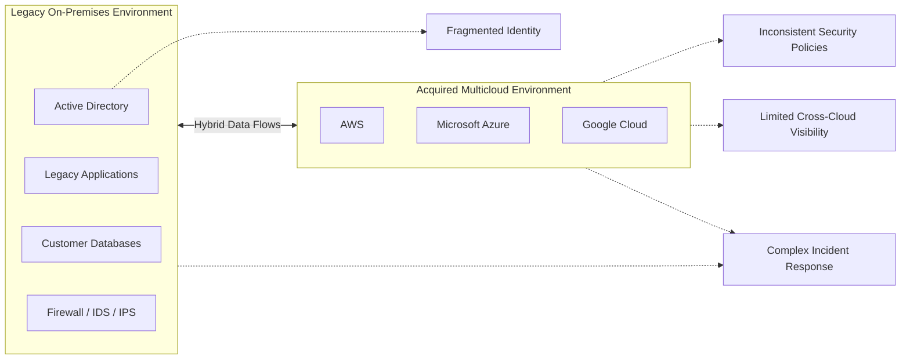
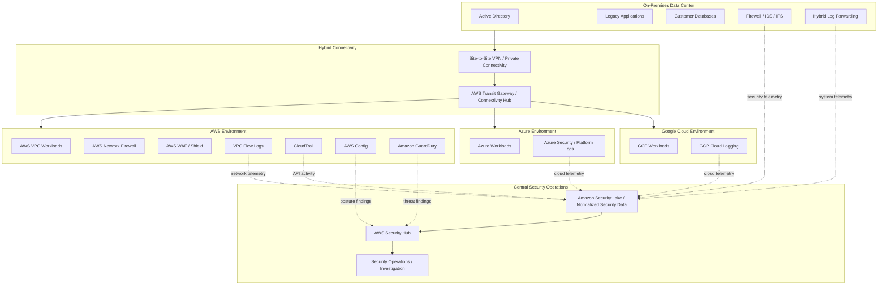
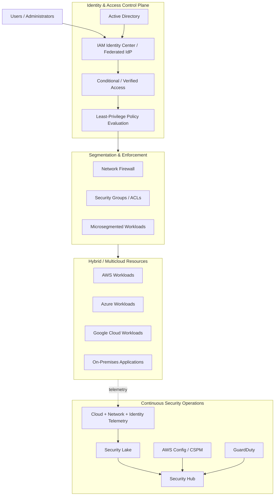
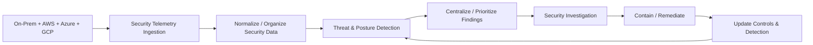

# Hybrid & Multicloud Security Architecture

## Overview

This repository presents a sanitized enterprise security architecture case study for integrating a legacy on-premises environment with workloads distributed across AWS, Microsoft Azure, and Google Cloud following an organizational merger.

The project focuses on the security problems that emerge when independently managed environments must operate as one enterprise platform: sensitive data movement, inconsistent identity and access controls, fragmented security telemetry, different cloud-native control models, regulatory obligations, and cross-environment incident response.

Rather than selecting a technology stack immediately, the design evaluates two competing security approaches and recommends a phased architecture based on security value, implementation complexity, operational risk, time to value, and cost.

> **Project scope:** architecture and security-control design. This repository does not represent a production deployment. The public documentation has been rewritten and sanitized from an academic security architecture exercise and does not reproduce institution-specific assessment materials.

---

## Business Problem

A large enterprise with a traditional on-premises data center acquires an organization operating workloads across AWS, Azure, and Google Cloud. The combined environment includes legacy applications, customer databases, Active Directory, traditional perimeter controls, and multicloud workloads.

### Primary Security Requirements

- Protect sensitive customer and transaction data in transit
- Centralize security visibility across on-premises and cloud environments
- Reduce inconsistent identity and access policies
- Support least-privilege access and stronger segmentation
- Aggregate security events for faster detection and investigation
- Improve cross-environment incident response
- Support compliance-oriented evidence collection and monitoring
- Preserve business continuity while security controls are modernized

---

## Existing-State Security Challenges

The central issue is not the absence of security controls. Each environment has controls. The problem is that they were designed and operated independently, creating blind spots at the boundaries between systems.

---

# Architecture Option 1

## Secure Hybrid Connectivity + Centralized Security Telemetry

The first option prioritizes rapid risk reduction by establishing protected connectivity and a centralized security-operations layer before undertaking a larger identity transformation.

### Security Objectives

- **Encrypted hybrid communications:** protected tunnels or private connectivity reduce exposure while sensitive data moves between environments.
- **Centralized security telemetry:** cloud, network, identity, and on-premises logs feed a common analysis layer.
- **Threat detection and posture visibility:** GuardDuty, Security Hub, Config, CloudTrail, VPC Flow Logs, firewall logs, and cloud-provider telemetry contribute different views of enterprise risk.
- **Preservation of existing systems:** visibility and connectivity can improve without requiring immediate replacement of legacy applications or Active Directory.

---

# Architecture Option 2

## Zero Trust + Identity-Centric Security + Continuous Posture Management

The second option treats identity, authorization, segmentation, and continuous verification as the primary control plane across the hybrid and multicloud environment.

### Zero Trust Principles Applied

- No implicit trust based only on network location
- Federated identity where practical
- Least-privilege authorization
- Continuous verification of access requests
- Microsegmentation between workload groups
- Central security posture monitoring
- Consistent logging across environments
- Reduced reliance on broad perimeter trust

---

## Architecture Tradeoff Analysis

| Decision Area | Option 1: Connectivity + Centralized Telemetry | Option 2: Zero Trust + CSPM |
|---|---|---|
| Immediate Risk Reduction | Strong | Strong |
| Time to Initial Value | Faster | Slower |
| Identity Modernization | Limited initially | Core design objective |
| Centralized Visibility | Core strength | Core strength |
| Segmentation | Moderate | Strong / granular |
| Legacy Compatibility | Easier | More challenging |
| Implementation Complexity | Medium | High |
| Policy Development | Moderate | Significant |
| Operational Change | Lower | Higher |
| Long-Term Security Maturity | Strong foundation | Higher target state |
| Cost Predictability | Easier initially | Higher transformation cost |

The comparison intentionally treats security architecture as an engineering decision rather than a feature checklist.

---

## Recommended Strategy

### Phase 1 — Stabilize and Centralize

The recommended first step is **secure hybrid connectivity plus centralized security telemetry** because it addresses immediate merger risks, improves visibility without requiring a wholesale identity redesign, and establishes the event sources needed for later Zero Trust decisions.

### Phase 2 — Mature Toward Zero Trust

After connectivity and telemetry are stable, progressively introduce:

1. Federated identity
2. Least-privilege access reviews
3. Stronger workload segmentation
4. Conditional access
5. Continuous posture management
6. Identity-centric application access
7. Reduced dependence on broad network trust

This creates an evolutionary path instead of attempting a disruptive all-at-once security transformation.

---

## Centralized Security Operations Model

Example telemetry sources include on-prem firewall/IDS logs, application logs, AWS CloudTrail, VPC Flow Logs, GuardDuty findings, AWS Config findings, Azure platform/security telemetry, Google Cloud logging, and identity events.

---

## Identity and Access Strategy

The target approach is to move from fragmented account management toward consistent identity governance.

- Federate trusted enterprise identities where practical
- Require strong authentication for privileged access
- Apply least privilege
- Separate administrative and standard-user privileges
- Review cross-account and cross-cloud trust relationships
- Prefer role-based access over unmanaged standing permissions
- Log authentication and authorization events centrally
- Continuously review privileged identities and stale access

---

## Network Security Strategy

The architecture uses layered controls rather than relying on a single firewall boundary.

**Perimeter and edge:** existing firewall/IDS/IPS, cloud-native firewall controls, WAF/DDoS protections for public-facing applications.

**Internal segmentation:** security groups, network ACLs, cloud firewall policy, and microsegmentation for higher-risk workloads.

**Hybrid connectivity:** encrypted site-to-site communication, controlled routing between environments, explicit trust boundaries, and logging of cross-environment traffic where supported.

---

## Data Protection and Key Management

Security architecture must protect both data in transit and data at rest.

- Encrypt sensitive inter-environment communications
- Use centrally governed key-management services where appropriate
- Separate key administration from ordinary workload administration
- Rotate and audit cryptographic keys
- Limit key usage through identity policy
- Use managed certificate and PKI processes for trusted services
- Consider tokenization for highly sensitive regulated data when justified

---

## Compliance-Oriented Architecture

The scenario includes PCI DSS, GDPR, and CCPA considerations. The architecture does not treat a cloud service as automatically making an organization compliant. Instead, it supports compliance through controls such as identity logging, network-flow visibility, centralized security evidence, encryption, least privilege, configuration monitoring, threat detection, retention policies, and change/activity auditing.

---

## Risk Analysis and Mitigation

### Risk 1 — Telemetry Gaps

**Problem:** Legacy systems or external cloud platforms may fail to send complete logs into the centralized security platform.

**Mitigations:** pilot critical log sources first, use platform-appropriate agents or forwarding tools, validate each source after onboarding, monitor ingestion health, and retain native cloud logs as a secondary investigation source.

### Risk 2 — Security Data Cost Growth

**Problem:** Centralizing large volumes of cloud and network telemetry can create unplanned ingestion, storage, and transfer costs.

**Mitigations:** prioritize high-value events, filter duplicate telemetry, apply lifecycle/tiering policies, use cost allocation tags, establish budgets and alerts, and review ingestion and retention regularly.

### Risk 3 — Identity Transformation Complexity

**Problem:** Legacy applications may not support modern federation or conditional-access patterns.

**Mitigations:** inventory authentication dependencies, introduce federation in phases, preserve controlled legacy access where required, segment systems that cannot be modernized immediately, and use explicit exception ownership.

---

## Security Architecture Principles Demonstrated

- Defense in depth
- Zero Trust
- Least privilege
- Shared responsibility
- Centralized visibility
- Risk-based modernization
- Identity-centric security
- Segmentation and microsegmentation
- Continuous posture management
- Cost-aware security operations

---

## Validation

The underlying academic security-architecture assessment received a **passing evaluation on the first attempt**.

The evaluation validated competency in:

- Security problem identification
- Two competing network-security control solutions
- Project-parameter analysis
- Comparative strengths and weaknesses
- Selection and justification of the recommended architecture
- Security architecture diagram development
- Stakeholder benefit analysis
- Risk identification and mitigation planning
- Professional technical communication

The public repository does not reproduce the evaluator report or assessment materials.

---

## Skills Demonstrated

Hybrid cloud security • Multicloud security • Zero Trust • Identity federation • Least privilege • Network segmentation • Microsegmentation • AWS Transit Gateway concepts • Site-to-Site VPN / private connectivity • AWS Network Firewall • AWS WAF / Shield • Amazon Security Lake • AWS Security Hub • Amazon GuardDuty • AWS Config • AWS CloudTrail • VPC Flow Logs • Active Directory integration concepts • Security telemetry architecture • CSPM • IDS / IPS integration • Encryption and key management • Risk analysis • Compliance-oriented security design • Architecture tradeoff analysis

---

## Future Enhancements

This architecture could be extended into original hands-on labs using Terraform, centralized CloudTrail/VPC Flow Log collection, GuardDuty/Security Hub integration, Security Lake ingestion testing, IAM Identity Center federation, Network Firewall policy demonstrations, multi-account AWS Organizations, automated compliance checks, and incident-response playbooks.

---

## Academic Context

This repository is a sanitized professional case study derived from security-architecture competencies demonstrated in an academic Cloud and Network Security Models assessment.

The original business scenario, school-provided materials, assessment instructions, evaluator report, student information, and original submission artifacts are intentionally not published here. The architecture has been reframed for professional portfolio use while preserving the engineering decisions and security principles demonstrated by the work.
